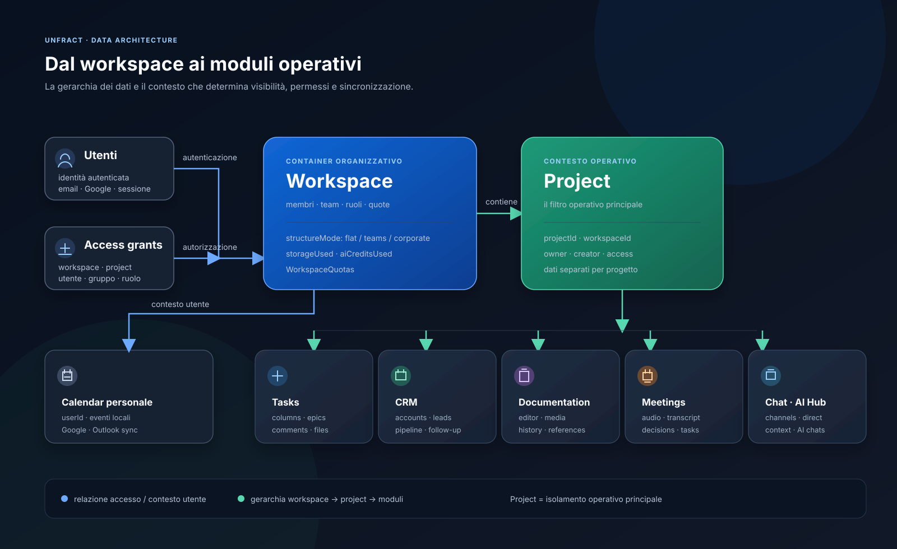
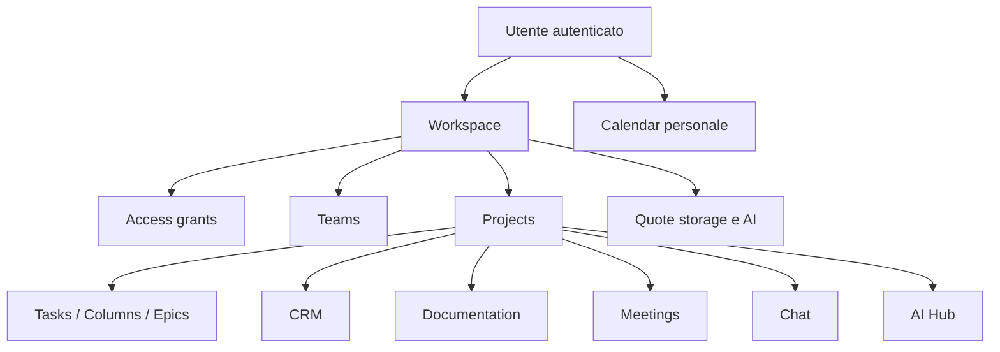
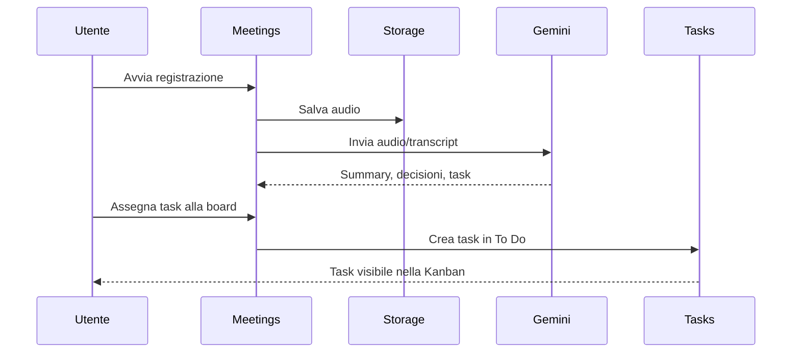

# Unfract
## Manuale operativo della piattaforma

> Guida per utenti, responsabili di workspace e amministratori di progetto.
> Le procedure descritte riflettono il comportamento attuale dell'applicazione. Le sezioni marcate **Nota tecnica** descrivono limiti o dipendenze che vanno considerati prima di usare il flusso in produzione.

## Indice

1. [Orientamento rapido](#orientamento-rapido)
2. [Workspace e Projects](#workspace-e-projects)
3. [Teams e amministrazione](#teams-e-amministrazione)
4. [Tasks](#tasks)
5. [CRM](#crm)
6. [Documentation](#documentation)
7. [Calendar](#calendar)
8. [Meetings](#meetings)
9. [Chat](#chat)
10. [AI Hub](#ai-hub)
11. [Quote e consumi](#quote-e-consumi)
12. [Integrazioni](#integrazioni)
13. [Scenari end-to-end](#scenari-end-to-end)
14. [Permessi e sicurezza](#permessi-e-sicurezza)
15. [Risoluzione problemi](#risoluzione-problemi)
16. [Piano schermate annotate](#piano-schermate-annotate)
17. [Appendice tecnica](#appendice-tecnica)

---

## Orientamento rapido

Dopo l'accesso, la piattaforma usa due selezioni globali:

- **Workspace:** contenitore organizzativo, membri, team, ruoli e quote.
- **Project:** contenitore operativo per Tasks, CRM, Documentation, Meetings, Chat e AI Hub.

La selezione resta memorizzata nel browser. Cambiare workspace o project cambia il contesto delle sezioni successive.

### Navigazione principale

| Sezione | Percorso | Contesto principale |
|---|---|---|
| Panoramica | `/dashboard` | Riepilogo del progetto, task e calendario |
| Attività | `/` | Project |
| Calendario | `/calendar` | Utente, con integrazioni calendario |
| Documentazione | `/documentation` | Project |
| Riunioni | `/meetings` | Project |
| CRM | `/crm` | Project |
| Organizzazione/Teams | `/organization` | Workspace e project |
| Chat | `/chat` | Project e membri |
| AI Hub | `/ai-hub` | Project e utente |

### Modello dati



Il diagramma mostra la gerarchia principale: gli utenti e gli access grant determinano l'accesso al Workspace; il Workspace contiene i Project; il Project determina il contesto operativo per Tasks, CRM, Documentation, Meetings, Chat e AI Hub. Calendar resta principalmente associato all'utente e può sincronizzarsi con provider esterni.



### Primo accesso consigliato

1. Accedi con Google o con email e password.
2. Seleziona o crea un Workspace.
3. Seleziona o crea un Project.
4. Verifica che siano presenti le colonne `To Do`, `Doing`, `Done`.
5. Invita il team dalla sezione Organization.
6. Configura lingua, fuso orario e preferenze notifiche.
7. Collega Google Calendar o Microsoft Outlook solo se serve la sincronizzazione.

---

## Workspace e Projects

### Workspace

Un Workspace rappresenta l'ambiente organizzativo. Contiene:

- nome e modalità organizzativa;
- owner e membri;
- gruppi/team;
- access grants;
- progetti collegati;
- logo e banner;
- quote di spazio e crediti AI.

Le modalità organizzative disponibili sono:

| Modalità | Uso consigliato | Stato attuale |
|---|---|---|
| `flat` | singolo team o workspace personale | disponibile |
| `teams` | più squadre operative | disponibile |
| `corporate` | struttura enterprise e IAM più articolato | parzialmente disponibile |

### Creare un Workspace

1. Aprire la Sidebar.
2. Aprire il selettore workspace.
3. Scegliere la creazione di un nuovo workspace.
4. Inserire il nome dell'azienda o del team.
5. Confermare.
6. Verificare che il nuovo workspace sia selezionato.

Il workspace viene creato con un piano free e quote iniziali. I valori mostrati dal pulsante Usage sono aggiornati in tempo reale quando Firestore riceve nuovi contatori.

### Project

Un Project è il contenitore operativo. Le attività e la maggior parte dei dati applicativi sono filtrati tramite `projectId`.

Un project può essere:

- creato dalla Sidebar;
- rinominato;
- eliminato;
- collegato a una o più organizzazioni storiche;
- associato a un Workspace tramite `workspaceId`.

### Creare un Project

1. Selezionare il Workspace corretto.
2. Aprire il selettore dei project.
3. Scegliere **Nuovo progetto**.
4. Inserire il nome.
5. Confermare.
6. Attendere la creazione asincrona delle colonne iniziali.

Il primo caricamento della Task Board crea normalmente `To Do`, `Doing` e `Done` se non esistono colonne e l'utente ha permessi di scrittura.

### Rinominare o eliminare un Project

La rinomina modifica solo il nome visualizzato.

L'eliminazione del project è distruttiva per il documento `projects`, ma non è una cancellazione a cascata garantita per tutte le collezioni collegate. Prima di eliminare:

1. esportare o archiviare i dati importanti;
2. verificare Tasks, CRM, Documentation, Meetings e Chat;
3. verificare eventuali integrazioni esterne;
4. eliminare manualmente i contenuti che non devono restare orfani.

> **Nota tecnica:** il sistema contiene una migrazione da organizzazioni e dati legacy. Workspace e Organization coesistono ancora in alcune aree.

---

## Teams e amministrazione

**Percorsi:** `/organization` e `/organization/[id]`.

### Funzioni disponibili

- creare o modificare un'organizzazione;
- gestire membri;
- invitare persone tramite email o link;
- caricare logo e banner;
- collegare project;
- creare team;
- aggiungere o rimuovere membri dai team;
- creare ruoli personalizzati;
- assegnare ruoli a utenti o team;
- gestire richieste di accesso.

### Invito tramite link

1. Aprire Organization.
2. Creare o selezionare l'organizzazione.
3. Copiare il link di invito.
4. Inviare il link al destinatario.
5. Il destinatario apre il link `/invite/[id]`.
6. Dopo l'autenticazione, il membro viene associato all'organizzazione e al relativo access grant.

### Invito tramite email

1. Aprire la sezione membri.
2. Inserire un indirizzo email valido.
3. Inviare l'invito.
4. Verificare la consegna tramite il provider email configurato.

### Team

Un team è un gruppo di utenti del workspace. Può ricevere un ruolo su un project attraverso la relazione:

```text
Workspace
  -> workspace_groups
  -> project_members
  -> project_roles
  -> permessi CRM / Tasks / Documentation / Settings
```

### Ruoli e livelli

I livelli applicativi sono:

- `none`: nessun accesso;
- `read`: sola lettura;
- `write`: lettura e modifica.

I moduli gestiti dal modello IAM custom sono:

- CRM;
- Tasks;
- Documentation;
- Settings.

Il project owner e il workspace admin ricevono normalmente permessi completi su questi moduli.

> **Nota tecnica:** Calendar, Meetings, Chat e AI Hub non sono ancora integrati in modo completo nello stesso modello IAM custom. Le regole Firestore attuali consentono lettura e scrittura a utenti autenticati; il controllo IAM è quindi principalmente applicativo.

---

## Tasks

**Percorso:** `/`.

La sezione offre tre viste:

- **Kanban:** colonne e card;
- **Elenco attività:** lista ordinabile e leggibile;
- **Cronologia:** timeline/Gantt con epics.

### Creare una task

1. Selezionare il Project corretto.
2. Aprire **Nuova attività**.
3. Inserire titolo.
4. Scegliere priorità:
   - Critica;
   - Alta;
   - Media;
   - Bassa.
5. Scegliere la colonna.
6. Facoltativamente aggiungere categoria, scadenza, descrizione ed epic.
7. Aggiungere eventuali allegati.
8. Salvare.

Il titolo è obbligatorio. Il salvataggio viene disabilitato durante l'upload di allegati per evitare task parziali.

### Modificare una task

Aprire la card o l'elemento della lista. È possibile modificare:

- titolo;
- descrizione;
- priorità;
- categoria;
- colonna;
- epic;
- scadenza;
- allegati;
- commenti.

### Drag and drop

- trascinare una task per riordinarla nella stessa colonna;
- trascinarla in una colonna diversa per cambiare stato;
- trascinare una colonna per cambiarne l'ordine.

La colonna `Done`/`Fatto` è considerata completata dalle viste e dall'AI Hub.

### Commenti e mention

Nei commenti è possibile:

1. digitare `@`;
2. scegliere un utente dal menu;
3. completare il testo;
4. inviare il commento.

Le mention possono attivare notifiche e email secondo le preferenze.

### Epics e timeline

Gli epics raggruppano task correlate. La timeline mostra:

- epics nella colonna laterale;
- mesi nella griglia;
- intervalli temporali delle task;
- stato completato e priorità.

### Allegati e quote

Gli allegati task vengono caricati su Firebase Storage. Il sistema conserva percorso, dimensione, workspace e flag di tracking per poter:

- incrementare lo spazio dopo un upload riuscito;
- decrementare lo spazio dopo una cancellazione riuscita;
- evitare conteggi duplicati durante cleanup o retry.

---

## CRM

**Percorso:** `/crm`.

Il CRM è organizzato in quattro aree operative.

### Contatti e aziende

Include:

- Accounts/Aziende;
- Contacts/Contatti;
- Customers/Clienti;
- Lead;
- liste personalizzate;
- filtri e viste salvate;
- importazione dati.

Un account può essere collegato a contatti, clienti, opportunità, documenti e timeline.

### Opportunità e pipeline

La pipeline gestisce:

- fasi;
- valore economico;
- probabilità;
- forecast;
- riordino;
- vista board e tabella;
- transizioni di stato.

### Follow-up

Un follow-up rappresenta un'azione commerciale con:

- assegnatario;
- priorità;
- scadenza;
- stato;
- collegamento a lead, account, contact o customer.

### Importazione

Flusso consigliato:

1. aprire Import;
2. caricare CSV/XLSX;
3. verificare fogli e intestazioni;
4. mappare le colonne;
5. controllare duplicati e validazioni;
6. eseguire l'import;
7. verificare il riepilogo e gli eventuali errori.

### Conversione Lead

La conversione può generare:

- account;
- contact;
- customer;
- opportunity.

Il lead originale non viene necessariamente eliminato. Verificare i record creati prima di ripetere una conversione.

### Documenti CRM

I documenti CRM supportano:

- PDF, Office, testo, immagini, audio e video secondo i formati consentiti;
- collegamento a entità CRM;
- tag;
- visibilità;
- versioni;
- download audit;
- retention date.

Le versioni precedenti restano nello Storage: lo spazio cresce a ogni nuova versione.

### Prospect research e report AI

Il modulo può:

1. cercare un'azienda;
2. raccogliere fonti e segnali;
3. proporre un candidato;
4. stimare dati mancanti;
5. correggere il settore;
6. generare una bozza di report;
7. validare le sezioni AI prima del salvataggio.

Se l'AI non è disponibile, il report può essere composto dai dati raccolti senza testo generato.

> **Nota tecnica:** le query operative sono principalmente isolate da `projectId`. L'`organizationId` è registrato nei record ma non sostituisce il filtro project.

---

## Documentation

**Percorsi:** `/documentation` e `/documentation/[id]`.

### Organizzazione

I documenti possono avere una gerarchia tramite `parentId`. È possibile usarli per:

- procedure;
- note di progetto;
- specifiche;
- verbali;
- knowledge base;
- documenti collegati a task e meeting.

### Editor

L'editor supporta:

- titoli e sottotitoli;
- paragrafi e liste;
- grassetto, sottolineato e font;
- dimensione testo;
- link;
- blocchi codice con evidenziazione;
- immagini, video e audio;
- slash menu;
- riferimenti a task, eventi, meeting e documenti;
- commenti e cronologia.

### Media

Procedura:

1. aprire il documento in modifica;
2. usare il comando media o il pulsante upload;
3. selezionare il file;
4. attendere il completamento;
5. verificare il contenuto nell'editor;
6. salvare il documento.

I media registrati salvano percorso, dimensione e workspace per permettere il calcolo delle quote e la cancellazione futura.

### AI nell'editor

1. aprire il comando AI;
2. inserire la richiesta;
3. scegliere, se disponibile, il modello cloud o locale;
4. controllare il contenuto generato;
5. inserirlo nel documento;
6. salvare manualmente.

I modelli locali Gemini Nano/WebLLM non consumano crediti cloud. La generazione cloud incrementa i crediti AI workspace.

---

## Calendar

**Percorso:** `/calendar`.

### Viste

- giorno;
- settimana;
- mese;
- anno.

### Evento locale

1. scegliere giorno e ora;
2. creare un evento;
3. inserire titolo e descrizione;
4. aggiungere invitato email, se necessario;
5. scegliere colore e durata;
6. salvare.

Gli eventi locali sono memorizzati per utente, non per project.

### Export e video

Gli eventi possono essere esportati in `.ics`. È possibile usare:

- link riunione predefinito;
- link video locale;
- Google Meet;
- Microsoft Teams quando l'integrazione è collegata.

### Disponibilità e booking

Nelle impostazioni calendario si definiscono:

- giorni lavorativi;
- intervalli orari;
- durata slot;
- account collegati.

Il link pubblico `/book/[userId]` permette a un visitatore di scegliere uno slot disponibile.

### Integrazioni

**Google Calendar** richiede OAuth e permessi Calendar. **Microsoft Outlook** usa Microsoft OAuth/Graph. Gli eventi esterni sono visualizzati come read-only e devono essere modificati nel calendario originale.

> **Nota tecnica:** il flusso pubblico di booking usa una durata fissa di 30 minuti nel route server, anche se gli slot configurabili possono indicare durate diverse.

---

## Meetings

**Percorsi:** `/meetings` e `/meetings/[id]`.

### Registrare

1. aprire Meetings;
2. consentire microfono e Web Speech API;
3. avviare la registrazione;
4. usare PiP se serve mantenere i controlli visibili;
5. fermare la registrazione;
6. attendere upload audio e analisi AI.

Il sistema salva:

- audio compresso;
- trascrizione live/parziale;
- riepilogo;
- decisioni;
- task estratte;
- durata;
- responsabile.

### Dopo l'elaborazione

Nella pagina dettaglio è possibile:

- ascoltare l'audio;
- leggere il transcript;
- generare un nuovo titolo;
- modificare task estratte;
- assegnare task alla Task Board;
- rimuovere l'assegnazione;
- aprire la trascrizione completa;
- scaricare il transcript.

Le task create da un meeting conservano il riferimento al meeting originale.

### Fallback

Se Gemini fallisce, il meeting viene comunque salvato con audio e testo grezzo. Una successiva rielaborazione può consumare un altro credito AI.

> **Nota tecnica:** la registrazione richiede un browser compatibile e permesso microfono. La cancellazione automatica dopo la scadenza dipende dal TTL configurato su Firebase.

---

## Chat

**Percorso:** `/chat`.

### Canali e messaggi diretti

- **Canali:** conversazioni di progetto;
- **Messaggi diretti:** conversazioni tra due membri.

La lista dei membri disponibili deriva dalle organizzazioni collegate al project.

### Creare un canale

1. aprire Chat;
2. premere `+` nella sezione Canali;
3. inserire un nome senza spazi;
4. confermare;
5. selezionare il nuovo canale.

### Messaggio diretto

1. aprire Messaggi Diretti;
2. cercare un membro;
3. selezionarlo;
4. inviare il messaggio.

### Mention e allegati

È possibile menzionare:

- utenti;
- task;
- documenti;
- meeting.

Gli allegati supportati includono immagini, video, audio e file. Il sistema salva il percorso Storage e i metadati necessari per il conteggio e la pulizia.

### Eliminazione

- **Elimina per me:** nasconde il messaggio per l'utente corrente, senza eliminare il file condiviso.
- **Elimina per tutti:** elimina gli allegati condivisi, aggiorna il contatore storage e marca il messaggio come eliminato.
- **Elimina chat:** elimina chat, messaggi e allegati tracciati.

> **Nota tecnica:** le operazioni di cancellazione devono essere usate con cautela perché i permessi effettivi dipendono anche dalle regole Firestore/Storage configurate.

---

## AI Hub

**Percorso:** `/ai-hub`.

### Contesto

L'AI Hub usa il project attivo e costruisce un contesto live con:

- nome project;
- task ancora aperte;
- colonne correnti;
- priorità;
- stato derivato dalla colonna.

Le task in `Done`, `Fatto`, `Completed` o con `completedAt` non vengono proposte come attività da fare.

### Chat persistente

Le conversazioni sono salvate per:

- project;
- utente;
- chat attiva.

Le chat personali non sono automaticamente condivise con gli altri membri del project.

### Domande utili

Esempi:

- `Quali attività aperte hanno priorità alta?`
- `Riassumi le task senza scadenza.`
- `Quali attività posso chiudere questa settimana?`
- `Crea una task per preparare il follow-up con il cliente Alfa.`
- `Collega le task aperte agli ultimi meeting.`

### Creazione automatica task

Quando il modello produce il blocco strutturato previsto:

1. l'app seleziona la prima colonna del project;
2. crea una task Firestore;
3. sostituisce il blocco con un riferimento `[TASK:id]`;
4. mostra la task nella risposta.

La creazione dipende dal formato corretto della risposta del modello.

### Allegati

Gli allegati AI Hub vengono caricati in Storage, contano nello spazio workspace e sono eliminati quando si elimina la chat AI che li contiene.

### Modelli

- Gemini cloud: consuma crediti AI;
- Gemini Nano/WebLLM locale: non consuma crediti cloud;
- MCP: Unfract è un server MCP remoto (`/api/mcp`). Il pulsante «Collega un assistente AI» mostra l'indirizzo da aggiungere come connettore in Claude, ChatGPT o Cursor. L'utente entra (email o Google), sceglie **un** workspace e conferma (`/oauth/authorize`); l'assistente legge progetti, task, bacheche, documenti, riunioni, persone del workspace e il calendario dell'utente, con gli stessi permessi dell'app e senza CRM. Se l'utente mette la spunta «Permetti anche di creare, modificare…» nel consenso (parte spenta), l'assistente può anche creare, modificare, spostare e commentare task, a nome dell'utente: valgono il permesso «Task» in scrittura e le regole del flusso di lavoro, partono le stesse notifiche dell'app e la task porta il segno dell'assistente (`createdVia` / `lastModifiedVia`). Non può mai cancellare nulla. I collegamenti si vedono e si revocano in Impostazioni profilo → «Assistenti AI collegati». Dettagli tecnici in `lib/server/mcp/`.
- Il proprietario o un amministratore di un'organizzazione può spegnere gli assistenti AI per quel workspace (pagina dell'organizzazione → «Assistenti AI (MCP)»): gli assistenti collegati si fermano subito e non se ne possono collegare di nuovi; riaccendendo riprendono.
- MCP è acceso in sviluppo e su quality; in prod solo con la variabile `MCP_ENABLED=true`. Spento, le route rispondono 404 e il modale dice che la funzione non è attiva.

> **Sicurezza:** la chiave Gemini pubblica è utilizzata da alcune funzioni client. Per un ambiente pubblico è preferibile spostare le chiamate cloud dietro route server autenticate.

---

## Quote e consumi

Il pulsante Usage nella TopBar mostra:

- storage utilizzato e limite;
- crediti AI utilizzati e limite;
- piano workspace;
- stato di aggiornamento mensile dei crediti AI.

### Storage conteggiato

Sono coperti i principali upload di:

- documentazione;
- CRM e versioni CRM;
- task attachment;
- chat e voice message;
- AI Hub;
- audio meeting;
- banner e logo organizzazione.

I valori piccoli sono mostrati in KB o MB, non arrotondati subito a zero GB.

### Crediti AI conteggiati

Sono conteggiati i principali percorsi cloud:

- risposte AI Hub;
- titoli AI Hub;
- generazione AI nella documentazione;
- trascrizione/rielaborazione meeting;
- generazione titolo meeting cloud;
- report AI prospect CRM.

Le elaborazioni locali non consumano crediti cloud. Il contatore AI usa un periodo mensile UTC.

### Interpretazione dei valori

Il contatore non è una scansione retroattiva dell'intero bucket. I file caricati prima che fossero disponibili i metadati di tracking possono non essere attribuibili. I workspace legacy vengono inizializzati quando vengono caricati.

---

## Integrazioni

### Firebase

Usato per:

- Authentication;
- Firestore;
- Storage;
- sincronizzazione realtime;
- notifiche e dati applicativi.

### Google

Usato per:

- login Google;
- Google Calendar;
- Google Meet quando previsto;
- Gemini AI.

Il login Google e il collegamento Calendar sono flussi separati. Il collegamento Calendar richiede OAuth aggiuntivo e può richiedere verifica Google per gli scope sensibili.

### Microsoft

Microsoft OAuth/Graph è usato per Outlook Calendar e Microsoft Teams.

### Email

Inviti, notifiche task, mention e messaggi possono passare dal provider email configurato server-side.

### Stripe

È presente per il flusso di upgrade/piano. La disponibilità effettiva dipende dalle chiavi e dai webhook configurati.

### WebLLM e Web Speech API

Sono integrazioni locali del browser:

- WebLLM richiede WebGPU e può scaricare modelli pesanti;
- Web Speech API richiede supporto browser e permesso microfono;
- i risultati locali non vengono conteggiati come crediti Gemini cloud.

---

## Scenari end-to-end

### 1. Dal meeting alla task operativa



### 2. Prospect CRM con report AI

1. Cercare il prospect.
2. Scegliere il candidato.
3. Raccogliere fonti e segnali.
4. Ricalcolare le stime.
5. Generare il report.
6. Controllare le sezioni AI.
7. Salvare la bozza.
8. Convertire il prospect in record CRM quando i dati sono verificati.

### 3. Documento con media e AI

1. Creare un documento nel project.
2. Caricare media.
3. Inserire il media nell'editor.
4. Usare AI per riassunto o riscrittura.
5. Salvare.
6. Eliminando il documento, i media con metadati completi vengono rimossi e il relativo spazio viene rilasciato.

### 4. Calendar personale + meeting operativo

1. Collegare Google Calendar o Outlook.
2. Sincronizzare gli eventi.
3. Visualizzare gli eventi esterni come read-only.
4. Creare un evento locale o prenotabile.
5. Organizzare un meeting.
6. Usare il link video predefinito.

### 5. Chat con allegato condiviso

1. Aprire un canale del project.
2. Caricare un file.
3. Inviare il messaggio.
4. Il file viene conteggiato nello storage workspace.
5. Eliminare per sé per nasconderlo solo localmente.
6. Eliminare per tutti per rimuovere il file condiviso e liberare lo spazio.

---

## Permessi e sicurezza

### Accesso applicativo

- autenticazione obbligatoria;
- ruoli custom per CRM, Tasks, Documentation e Settings;
- project owner e workspace admin con accesso completo applicativo;
- richieste di accesso per moduli non autorizzati.

### Verifiche prima di concedere accesso

1. verificare che l'utente appartenga al workspace;
2. aggiungere l'utente o il team al project;
3. assegnare un ruolo;
4. concedere `read` prima di `write` se serve un accesso progressivo;
5. verificare una pagina di sola lettura e una modifica controllata.

### Dati sensibili

La piattaforma può gestire:

- transcript audio;
- dati CRM;
- email e contatti;
- file caricati;
- dati di calendario.

Configurare dominio, OAuth, privacy policy, regole Firebase e segreti server prima di un uso pubblico.

> **Nota tecnica importante:** le regole Firestore/Storage presenti nel repository sono permissive per utenti autenticati. Per un ambiente multi-tenant pubblico è necessario irrigidire le regole server-side e validare workspace/project ownership lato server.

---

## Risoluzione problemi

### Usage resta a zero

1. verificare che esista un Workspace attivo;
2. ricaricare la pagina dopo il primo upload;
3. controllare che il project sia associato al workspace;
4. aprire la console browser e cercare `Failed to increment`;
5. verificare che il documento `workspaces/{id}` contenga `quotas`;
6. controllare che l'upload sia terminato senza errori.

### Crediti AI non aumentano

1. distinguere modello locale da Gemini cloud;
2. controllare che la chiamata Gemini sia riuscita;
3. verificare `aiCreditsPeriod` del workspace;
4. ricaricare il contesto workspace;
5. controllare errori Firestore in console.

### Task non visibili

1. controllare project attivo;
2. controllare `canRead('tasks')`;
3. attendere la creazione delle colonne;
4. verificare che `projectId` della task coincida con il project attivo;
5. controllare la connessione realtime.

### Meeting non trascrive

1. usare Chrome desktop aggiornato;
2. concedere microfono;
3. verificare Web Speech API;
4. controllare Gemini API key;
5. verificare che audio e transcript siano comunque salvati nel fallback.

### Login Google blocca il redirect

1. verificare il client OAuth web corretto;
2. usare l'URI Firebase esatto `https://app.unfract.com/__/auth/handler`;
3. controllare domini autorizzati Firebase;
4. verificare che il secret appartenga allo stesso Client ID;
5. per Calendar, distinguere il callback `/api/auth/google/callback` dal callback Firebase del login.

### Traduzione parziale

1. cambiare lingua dal profilo;
2. verificare che il cookie `NEXT_LOCALE` sia `it` o `en`;
3. ricaricare se una sezione usa testi hardcoded;
4. segnalare la schermata e la voce rimasta nella lingua precedente.

---

## Piano schermate annotate

Il repository non contiene ancora screenshot verificati di ogni sezione. Per completare la guida con immagini reali, catturare le seguenti schermate in un workspace demo dedicato, senza dati personali:

| ID | Schermata | Evidenziare |
|---|---|---|
| S01 | Sidebar + selettori Workspace/Project | contesto attivo e navigazione |
| S02 | Organization overview | membri, inviti, logo/banner |
| S03 | Teams e ruoli project | team, ruolo, permessi read/write |
| S04 | Task Board | viste, colonne, Nuova attività, card |
| S05 | Task detail | priorità, epic, scadenza, allegati, commenti |
| S06 | CRM dashboard | KPI, filtri, navigazione moduli |
| S07 | CRM pipeline | fasi, valore, probabilità, drag/drop |
| S08 | CRM import | mapping, duplicati, conferma |
| S09 | Documentation editor | toolbar, slash menu, riferimenti, AI |
| S10 | Calendar month | viste, sync, settings |
| S11 | Calendar integration | Google/Outlook connect e stato |
| S12 | Meetings detail | audio, transcript, decisioni, task |
| S13 | Chat | canali, DM, mention, allegati |
| S14 | AI Hub | contesto task, chat, upload, task creation |
| S15 | Usage dropdown | storage, crediti AI, periodo |

### Regole per l'annotazione

- usare un workspace demo con nomi fittizi;
- oscurare email, avatar e token;
- evidenziare con riquadri numerati, non con frecce sovrapposte al testo;
- usare una schermata desktop e una mobile per S01, S04, S09, S10, S13 e S14;
- per i flussi OAuth usare screenshot separati della console Google/Firebase senza mostrare secret;
- salvare gli asset in `docs/screenshots/` con nomi `S01-sidebar.png`, `S02-organization.png`, ecc.;
- collegare ogni immagine alla procedura corrispondente con una didascalia e un riferimento all'ID.

### Sequenza consigliata per il secondo passaggio

1. catturare S01, S04, S09, S10, S12, S13, S14 e S15;
2. aggiungere riquadri numerati;
3. inserire le immagini nelle sezioni del manuale;
4. aggiungere versione mobile;
5. fare una revisione finale dei testi contro l'app demo.

---

## Appendice tecnica

### Collezioni principali

```text
users/{uid}
users/{uid}/events
workspaces/{workspaceId}
access_grants/{grantId}
workspace_groups/{groupId}
projects/{projectId}
tasks/{taskId}
columns/{columnId}
epics/{epicId}
meetings/{meetingId}
ai_chats/{chatId}
chats/{chatId}
messages/{messageId}
crm_* collections
documentation/{documentId}
```

### Quote

```text
workspaces/{workspaceId}.quotas.storageUsed
workspaces/{workspaceId}.quotas.storageLimit
workspaces/{workspaceId}.quotas.aiCreditsUsed
workspaces/{workspaceId}.quotas.aiCreditsLimit
workspaces/{workspaceId}.quotas.aiCreditsPeriod
```

### Principio di attribuzione

Per incrementare o liberare quote usare, in ordine di affidabilità:

1. `workspaceId` persistito insieme al file;
2. `projects/{projectId}.workspaceId`;
3. solo come fallback, il workspace selezionato nell'interfaccia.

Il workspace attivo nel browser non è una prova sufficiente di ownership per un'operazione server-side.

### Stato documentazione

Questa guida è il riferimento operativo attuale. Quando una funzione viene modificata:

1. aggiornare la sezione corrispondente;
2. aggiornare eventuali caveat;
3. aggiornare la matrice schermate;
4. verificare italiano e inglese;
5. indicare la data di revisione in un eventuale changelog.
